<div align="center">


[](https://git.io/typing-svg)

<br/>

[](https://www.linkedin.com/in/alvin-rizky-13034a375)
[](https://discord.com/users/1270375691099045953)
[](https://www.instagram.com/allvinrizky_)

</div>

---


### ⚡ &nbsp;Terminal / Whoami

```bash
alvin@pelita-nusantara:~$ neofetch --dev
  OS       : Arch Linux x86_64 / Android / Web
  Host     : SMK Plus Pelita Nusantara, Bogor (RPL)
  Role     : Junior Full-Stack & Mobile Developer
  Focus    : Flutter (Mobile) • Go & Laravel (Backend) • Modern Frontend
  Workflow : Git, REST APIs, Microservices, Clean Architecture
  Status   : 🚀 Shipping full-stack apps & grinding daily
  Motto    : "Code with passion, build with precision."
```

<br clear="right"/>

---

### 🏆 &nbsp;Achievements & Trophies

<div align="center">

[](https://github.com/ryo-ma/github-profile-trophy)

</div>

---

### 🚀 &nbsp;Featured Projects & Works

<table>
  <tr>
    <td width="50%" valign="top">
      <a href="https://github.com/Llyod-17/BE-Absensi-Siswa">
        
      </a>
      <p align="center">
        <b>Absensi Siswa Backend</b><br/>
        <sub>High-performance REST API built in Go for student attendance tracking.</sub>
      </p>
    </td>
    <td width="50%" valign="top">
      <a href="https://github.com/Llyod-17/SneakHub">
        
      </a>
      <p align="center">
        <b>SneakHub</b><br/>
        <sub>Modern TypeScript web app with responsive UI & clean state management.</sub>
      </p>
    </td>
  </tr>
  <tr>
    <td width="50%" valign="top">
      <a href="https://github.com/Llyod-17/wello-p4">
        
      </a>
      <p align="center">
        <b>Wello P4</b><br/>
        <sub>Full-stack Laravel & Blade project with authentication & database integration.</sub>
      </p>
    </td>
    <td width="50%" valign="top">
      <a href="https://github.com/Llyod-17/fe-astronova">
        
      </a>
      <p align="center">
        <b>FE Astronova</b><br/>
        <sub>Svelte frontend experiment featuring slick animations and lightweight bundle.</sub>
      </p>
    </td>
  </tr>
</table>

---

### 🛠️ &nbsp;Tech Arsenal

<div align="center">

#### 📱 Mobile Development


#### ⚙️ Backend & Database


#### 🖥️ Frontend & Ecosystem


</div>

---

### 📊 &nbsp;GitHub Analytics & Streak

<div align="center">


&nbsp;


<br/>


<br/>



<br/>


</div>

---

### 💬 &nbsp;Random Dev Wisdom

<div align="center">

[](https://github.com/piyushsuthar/quotes-github-readme)

</div>

---

<div align="center">

<a href="https://github.com/Llyod-17">
  
</a>


</div>
