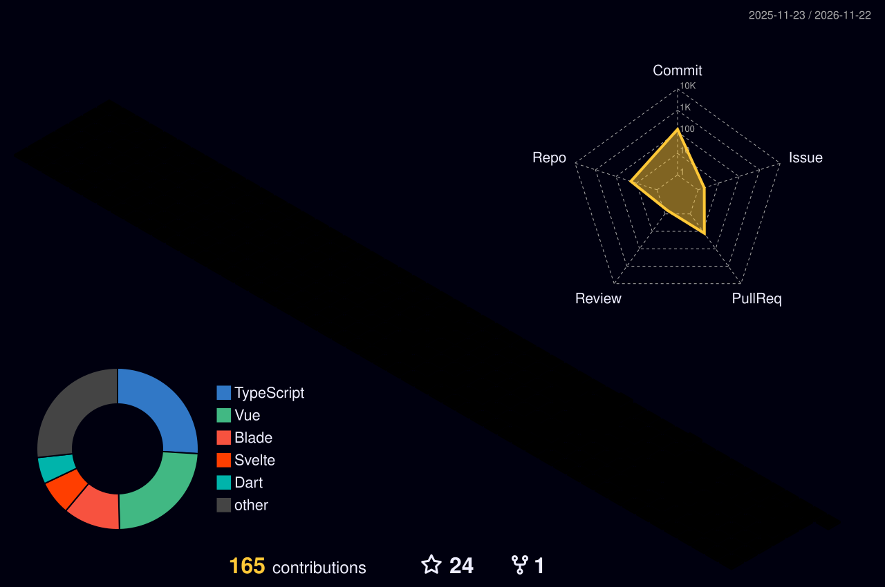

  

# Welcome To Parker4real.git
### `Looking Forward For A New Tech`

 

---

### ✦ WHOAMI

<table>
  <tr>
    <td width="75%" valign="center">
      <blockquote>
        <b>Alvin Rizky</b> (<code>Parker4real</code> / <code>Llyod-17</code>) 
        Siswa Rekayasa Perangkat Lunak (RPL) @ <b>SMK Plus Pelita Nusantara, Bogor</b>. 
        Lagi fokus build app <b>Flutter</b> sekalian <b>full-stack web</b>. Suka eksplor tech baru, clean architecture, dan ngulik hal-hal seru di dunia programming.
      </blockquote>
    </td>
    <td width="25%" align="center">
      
    </td>
  </tr>
</table>

 

  

### ✦ Tech Stack

---

### ✦ Featured Projects

<table width="100%">
  <tr>
    <td width="50%" align="center">
      
    </td>
    <td width="50%" align="center">
      
    </td>
  </tr>
</table>

---

### ✦ GitHub Activities & Contributions

  

  
  

  

  

  

 

<!-- Lofi / Anime Music Player Card -->
<table style="border: 1px solid #30363d; border-radius: 8px;">
  <tr>
    <td width="65" align="center">
      
    </td>
    <td>
      <b>Now Playing:</b> <i>Midnight City Vibes ~ Lofi Coding Session</i> 🎧 
      <code>▶ 01:47 ━━━━━━━━●─────── 03:24 &nbsp; 🔁 &nbsp; 🔀 &nbsp; 🔊</code>
    </td>
  </tr>
</table>

 

