  

# Welcome To Parker4real.git
### `Looking Forward For A New Tech`

 

---

### ✦ WHOAMI

> **Alvin Rizky** (`Parker4real` / `Llyod-17`)  
> Siswa Rekayasa Perangkat Lunak (RPL) @ **SMK Plus Pelita Nusantara, Bogor**  
> Lagi fokus build app Flutter sekalian full-stack web. Suka eksplor tech baru & ngulik hal-hal seru di dunia programming.

 

  

### ✦ Tech Stack

 

---

### ✦ GitHub Activities

  
  

  

  

  

